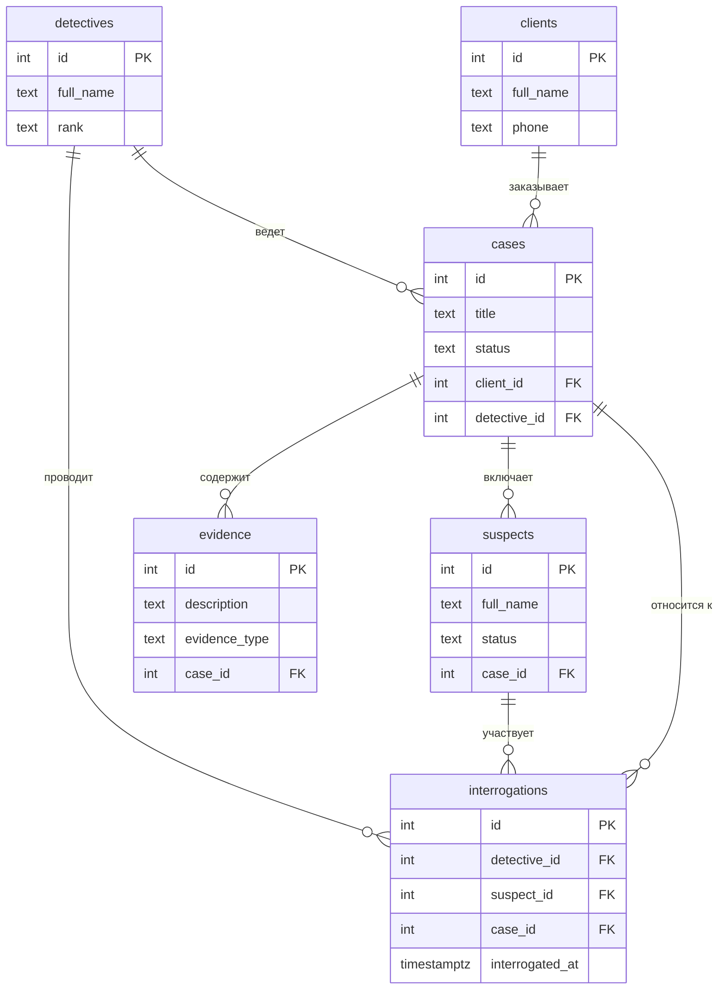

<!--
  Это шаблон. После создания своего репозитория:
  1. Назовите репозиторий db-<фамилия>-<тема>, например db-ivanova-cinema.
  2. Заполните разделы ниже под свою тему и удалите этот комментарий.
-->

# Название проекта: Детективное агенство

Тема № 27: **Дектективное агенство**. Одно предложение: какие данные хранит база и кому они нужны. (База данных хранит информацию о расследованиях, клиентах, детективах, подозреваемых и собранных уликах. Она нужна для систематизации работы агентства, чтобы ни одно дело не осталось без внимания, а улики были строго привязаны к своим делам.)

| | |
| --- | --- |
| Главная таблица | `cases` (Дела) |
| Связь N:M | `detectives` (Детективы) и `suspects` (Подозреваемые) через `interrogations` (Допросы) |
| Бизнес-правило | Дело нельзя закрыть без улик (на уровне БД статус контролируется через `CHECK`, а наличие улик — логикой приложения) |
| СУБД | PostgreSQL 17 в Docker |

## Описание предметной области

База данных спроектирована для внутреннего учета детективного агентства. Она помогает руководству контролировать загрузку сотрудников, а детективам — быстро находить информацию по текущим делам и связанным с ними лицам. 

В базе выделены следующие сущности (таблицы):
*   **`detectives`** — сотрудники агентства. Хранит ФИО и должность (звание).
*   **`clients`** — заказчики услуг. Хранит ФИО и контактные данные (телефон, email).
*   **`cases`** — центральная таблица. Описывает конкретное расследование. Привязана к клиенту (кто заказал) и к детективу (кто ведет). Имеет строгий статус.
*   **`suspects`** — лица, проходящие по делу (подозреваемые, свидетели). Привязаны к конкретному делу.
*   **`evidence`** — улики и вещественные доказательства, собранные по делу.
*   **`interrogations`** — связующая таблица (N:M). Фиксирует факт допроса конкретного подозреваемого конкретным детективом по определенному делу.

## Задания курса

Правила курса, установка и порядок сдачи: [docs/README.md](docs/README.md).

| Лаба | Задание |
| --- | --- |
| 1. Модель данных и схема | [docs/lab-1.md](docs/lab-1.md) |
| 2. Запросы | [docs/lab-2.md](docs/lab-2.md) |
| 3. Логика в базе | [docs/lab-3.md](docs/lab-3.md) |
| 4. Транзакции и доступ | [docs/lab-4.md](docs/lab-4.md) |
| 5. Производительность | [docs/lab-5.md](docs/lab-5.md) |
| Витрина к защите | [docs/showcase.md](docs/showcase.md) |

## Как запустить

```bash
cp .env.example .env          # пароли и порт
docker compose up -d          # при первом запуске выполняются скрипты из db/
dbcheck run demo/lab1.sql     # сценарий лабы 1
```

Работа с базой: `docker compose exec db psql -U postgres -d app`. Сценарии выполняются в `psql` командой `\i /demo/lab1.sql`.

После изменения скриптов в `db/` базу нужно пересоздать: `docker compose down -v && docker compose up -d`.

## ER-диаграмма

<!-- Замените пример своими таблицами: 5+ таблиц, связь N:M через связующую таблицу. -->



## Ограничения

| Ограничение | Таблица и колонки | Зачем |
| --- | --- | --- |
| `UNIQUE` | `clients (phone)` | У каждого клиента должен быть уникальный номер телефона. Это не даст создать дубликат карточки клиента. |
| `UNIQUE` | `interrogations (detective_id, suspect_id, case_id)` | Один и тот же детектив не может провести два одинаковых допроса одного и того же подозреваемого по одному и тому же делу. Это защищает от дублирования записей в журнале допросов. |
| `CHECK` | `cases (status)` | Статус дела может быть только из строго заданного списка: 'Открыто', 'В работе', 'Закрыто успешно', 'Закрыто неудачно'. Запрещает вводить произвольный текст (например, опечатку "Зактрыто"). |
| `CHECK` | `cases (closed_at >= opened_at)` | Дата закрытия дела не может быть раньше даты его открытия. Это базовое логическое правило учета времени. |
| `CHECK` | `evidence (evidence_type)` | Тип улики ограничен конкретным списком: 'Документ', 'Фотография', 'Видео', 'Аудио', 'Физический объект'. Это нужно для единообразия классификации улик в базе. |

## Что сделано по лабам

| Лаба | Что сделано | Сценарий |
| --- | --- | --- |
| 1 | Созданы 6 таблиц, настроены PK, FK, ограничения (UNIQUE, CHECK). Добавлены тестовые данные (10+ строк). Написаны 3 запроса с ожидаемыми ошибками. | `demo/lab1.sql` |
| 2 | ... | `demo/lab2.sql` |
| 3 | ... | `demo/lab3.sql` |
| 4 | ... | `demo/lab4.sql`, `demo/race.sql`, `demo/race_fixed.sql` |
| 5 | ... | `demo/lab5.sql` |

<!--
  Разделы, которые добавляются по ходу курса:
  лаба 1 ★: «Нормализация», «Типы данных»; ★★: «Что происходит при удалении»;
  лаба 4: «Гонка»;
  лаба 5: «Производительность» (таблица до / после, когда индекс не помогает, размеры).
-->
